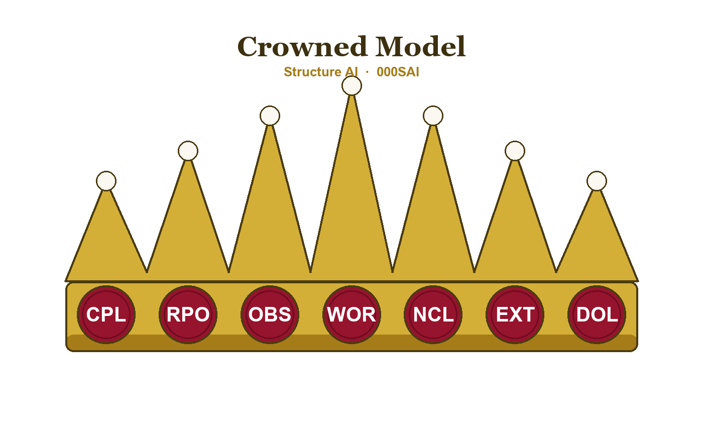

# Structure AI (000SAI)

Structure AI is a structure methodology for AI agents, includes the **Crowned Model** and **Framework AI (000FAI)**. This repository is an [Obsidian](https://obsidian.md) vault that defines the reference-code taxonomy and folder structure from which the operational vault is derived.



## The model

A strict containment hierarchy — each level lives inside the one above it:

1. **System (000SYS)** — user device
2. **Platforms (000PLA)** — Windows (000WIN) install and cPanel (000CPL) web-hosting plan
3. **Frameworks (000FRA)** — 000FAI (the reference-code framework) and TOGAF (000TOG)

### Framework AI (000FAI)

**Folders**

- **Organization (000ORG)**
  - **Governance (000GOV)** → Policies (000POL)
  - **Operations (000OPS)** → Agents (000AGT) → Personas (000PER), Skills (000SKI); Business Units (000BUS)
  - **Wiki (000WIK)** → Applications (000APP), Knowledge Bases (000KBS)

**Files**

| File | Code | Contents |
|------|------|----------|
| `COD.md` | 000COD | App codes, app objects, object types |
| `CTF.md` | 000CTF | Categories, tags, fields |
| `SPF.md` | 000SPF | Strings, patterns, flows |

## Conventions

- **Format:** `000` + 3-letter uppercase code (e.g. `000DOL`)
- **Content prefix pattern:** `{CODE}-{qualifier}` → `000WOR-000PGT-000CAS` = WordPress page for Customer & Sales
- **Hierarchical doc refs (body only, never as tags):** `WPS-DOL-BUS-ICS` chains codes with `-`; tags stay flat (`000WPS`, `000BUS`)
- **Frontmatter:** include the reference code as a tag, e.g. `tags: [dolibarr, 000DOL, config]`

## Repository layout

```
000SAI/
├── SAI.md                          Vault root — methodology overview
├── Crowned_Model.png               The Crowned Model diagram
└── 000SYS/                         System (user device)
    └── 000PLA/                     Platforms
        ├── 000CPL/                 cPanel (web hosting)
        └── 000WIN/                 Windows (local machine)
            └── 000FRA/             Frameworks
                ├── 000FAI/         Framework AI (reference-code framework)
                │   ├── COD.md      Code reference
                │   ├── CTF.md      Categories, tags & fields
                │   ├── SPF.md      Strings, patterns & flows
                │   └── 000ORG/             Organization
                │       ├── 000GOV/         Governance
                │       │   └── 000POL/     Policies
                │       ├── 000OPS/         Operations
                │       │   ├── 000AGT/     Agents
                │       │   │   ├── 000PER/ Personas
                │       │   │   └── 000SKI/ Skills
                │       │   └── 000BUS/     Business Units
                │       └── 000WIK/         Wiki
                │           ├── 000APP/     Applications
                │           │   ├── 000DOL/ Dolibarr
                │           │   ├── 000FLA/ Forum (Flarum)
                │           │   ├── 000NCL/ Nextcloud
                │           │   ├── 000OBS/ Obsidian
                │           │   └── 000WOR/ WordPress
                │           └── 000KBS/     Knowledge Bases
                └── 000TOG/                 TOGAF (enterprise architecture)
```

---

Created and maintained by Nathan Livingstone.
